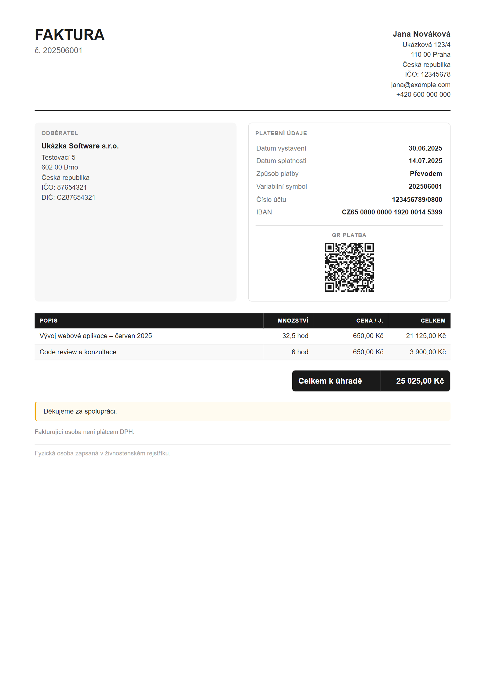

<div align="center">

# faktura-generator

**Generate Czech PDF invoices with a QR payment code — from a JSON file or straight from a Jira timesheet.**

[](https://github.com/JanCachaDev/faktura-generator/actions/workflows/ci.yml)
[](https://github.com/JanCachaDev/faktura-generator/releases)
[](LICENSE)




</div>

---

Built for Czech freelancers (OSVČ) who bill by the hour. Fill in your details once,
then every month run one command and get a ready-to-send PDF.

> The invoice itself is in **Czech** (labels, date and number format), as required for Czech invoicing.

## Features

- **One command → PDF invoice** (A4, print-ready, rendered with headless Chromium)
- **QR Platba** — SPAYD payment QR code your client can scan in any Czech banking app
- **Jira timesheet import** — sums hours per issue from a CSV export and turns them into invoice items
- **Automatic invoice numbers** (`YYYYMMNNN`), variable symbol, issue and due date
- **VAT or non-VAT payer** — VAT rows and the *„není plátcem DPH“* note are handled for you
- **CZK, EUR, USD**
- **Your data stays local** — personal configs are git-ignored, nothing is sent anywhere
- Tested on **Windows, macOS and Linux**

## Quick start

Requires [Bun](https://bun.sh) ≥ 1.1.

```bash
git clone https://github.com/JanCachaDev/faktura-generator.git
cd faktura-generator
bun install

cp supplier.example.json supplier.json   # your details — fill in once
cp invoice.example.json invoice.json     # client + items — update monthly

bun run invoice
# → faktura-Jana_Nováková-202506001.pdf
```

> On first install Puppeteer downloads Chromium (~170 MB). This happens only once.

<details>
<summary><b>Install as a global command instead</b> (from GitHub Packages)</summary>

```bash
# one-time: tell npm/bun where @jancachadev packages live
echo "@jancachadev:registry=https://npm.pkg.github.com" >> ~/.npmrc

bun add -g @jancachadev/faktura-generator
faktura --help
```

GitHub Packages requires a [personal access token](https://docs.github.com/en/packages/working-with-a-github-packages-registry/working-with-the-npm-registry#authenticating-to-github-packages) with `read:packages` even for public packages.
</details>

## Usage

### A) Items written by hand

List items in `invoice.json` and run `bun run invoice`:

```jsonc
{
  "issueDate": "2025-06-30",
  "pricePerUnit": 650,               // default hourly rate
  "client": { "name": "Klient s.r.o.", "ico": "87654321", "street": "…", "city": "…", "zip": "…", "country": "…" },
  "items": [
    { "description": "Vývoj webové aplikace – červen 2025", "quantity": 32.5, "unit": "hod" },
    { "description": "Licence", "quantity": 1, "unit": "ks", "pricePerUnit": 1200 }
  ]
}
```

### B) From a Jira timesheet CSV

```bash
bun run timesheet timesheet.csv
```

```
Items found:
  WZ-27          10,5 h  →  6 825 Kč
  WZ-28             4 h  →  2 600 Kč
  LL-3           0,75 h  →  487,5 Kč
  Total         15,25 h  →  9 912,5 Kč

Service type for "WZ" issues: Vývoj webu
Service type for "LL" issues: Konzultace
Generating invoice no. 202506001
…
Done: /path/to/faktura-Jana_Nováková-202506001.pdf
```

Hours are summed per issue and you are asked for a label for each project prefix
(`WZ`, `LL`, …). Items appear as e.g. *„Vývoj webu WZ-27“*. Your `invoice.json` is not modified.

Skip the questions with `--service`, handy for scripts:

```bash
bun run timesheet timesheet.csv -s "WZ=Vývoj webu" -s "LL=Konzultace"
```

The expected format is the Jira timesheet export: issue key in the first column, total
time in the second (`10h 30m`, `45m`, `1.5h`, `1d` = 8 h). Comma- and semicolon-separated
files both work — see [`timesheet.example.csv`](timesheet.example.csv).

### CLI reference

```
faktura [invoice]                 Generate a PDF from supplier.json + invoice.json
faktura timesheet <file.csv>      Generate a PDF from a Jira timesheet export

  -d, --dir <path>                Folder with the JSON configs (default: current folder)
  -s, --service <PREFIX=label>    Service label for an issue prefix (repeatable)
  -h, --help                      Show help
  -v, --version                   Show version
```

## Configuration

### `supplier.json` — you

| Field | Required | Description |
|---|:---:|---|
| `name`, `street`, `city`, `zip`, `country` | yes | Your name and address |
| `ico` | yes | IČO |
| `dic` | | DIČ (only if you have one) |
| `email`, `phone` | | Shown in the invoice header |
| `bankAccount` | yes | Czech account number, e.g. `123456789/0800` |
| `iban` | | Enables the QR payment code |
| `vatPayer`, `vatRate` | yes | `false` / `21` for most freelancers |
| `currency` | yes | `CZK`, `EUR` or `USD` |
| `footer` | | Small print, e.g. *„Fyzická osoba zapsaná v živnostenském rejstříku.“* |

### `invoice.json` — this month

Everything except `client` is optional; missing fields are filled in automatically:

| Field | Default |
|---|---|
| `issueDate` | today |
| `dueDate` | `issueDate` + `dueDays` (default 14 days) |
| `number` | `YYYYMM` + next free sequence number, based on PDFs already in the folder |
| `variableSymbol` | same as `number` |
| `paymentMethod` | `Převodem` |
| `pricePerUnit` | default rate for items that don't set their own |
| `note` | highlighted note under the totals |

## Development

```bash
bun test              # unit + end-to-end tests (generates real PDFs)
bun run typecheck     # TypeScript, strict mode
bun run preview       # regenerate docs/preview.png
```

```
src/
├── cli.ts        # argument parsing, interactive prompts
├── generate.ts   # loads configs, renders the PDF with Puppeteer
├── template.ts   # invoice HTML + CSS
├── core.ts       # pure logic: numbering, dates, money, QR, CSV parsing
└── types.ts
tests/            # bun test
```

Contributions are welcome — please open an issue first for bigger changes.
See [CHANGELOG.md](CHANGELOG.md) for release history.

## License

[MIT](LICENSE) © Jan Čácha
